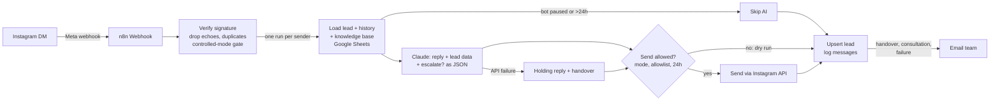

# GostProcess: AI Instagram DM Assistant

An n8n workflow that answers Instagram DMs for GostProcess. It explains your services, qualifies prospects, records leads in Google Sheets, and hands conversations to the team by email when a person is needed.

**Current status:** built and tested offline (simulated). Ships in `dry_run` mode: nothing is sent to Instagram until you approve.

## Architecture



## Repository map
| Path | What |
|---|---|
| `n8n/gostprocess-ig-dm-assistant.json` | **Import this** into n8n (main workflow) |
| `n8n/gostprocess-ig-error-notifier.json` | Import this too (emails you on any error) |
| `n8n/src/*.js` | Source of each Code node (edit here, then `npm test` rebuilds the JSON) |
| `prompts/system-prompt.md` | AI behaviour rules (tone, languages, honesty, handover) |
| `knowledge-base/knowledge.csv` | Company knowledge, imported into the sheet's **Knowledge** tab and editable there |
| `crm/*.csv` | Leads and Messages sheet headers |
| `docs/00-inspection-and-plan.md` | Inspection results and plan |
| `docs/01-setup-guide.md` | Step-by-step: Instagram, Google Sheet, n8n, Meta app |
| `docs/02-test-checklist.md` | What's tested, and what you still test with the real account |
| `docs/03-operations.md` | Troubleshooting, costs, deployment, data retention, reuse for clients |
| `tests/` | Simulated tests (`npm test`) and real-AI preview (`npm run ai-preview`) |

## Commands (Node.js 20+)
```bash
npm test                                  # rebuild workflow JSON + run 21 simulated tests (free, offline)
ANTHROPIC_API_KEY=... npm run ai-preview  # see real AI replies to test conversations (a few cents)
```

## Safety switches
- `Config → mode`: `dry_run` (default, never sends), `allowlist` (sends to listed test IDs only), or `live`.
- `Leads → bot_paused`: TRUE stops the bot for that prospect; set FALSE to resume.
- No credentials or tokens are stored in this repository or in the workflow JSON.
